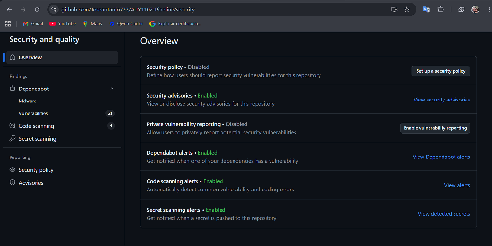
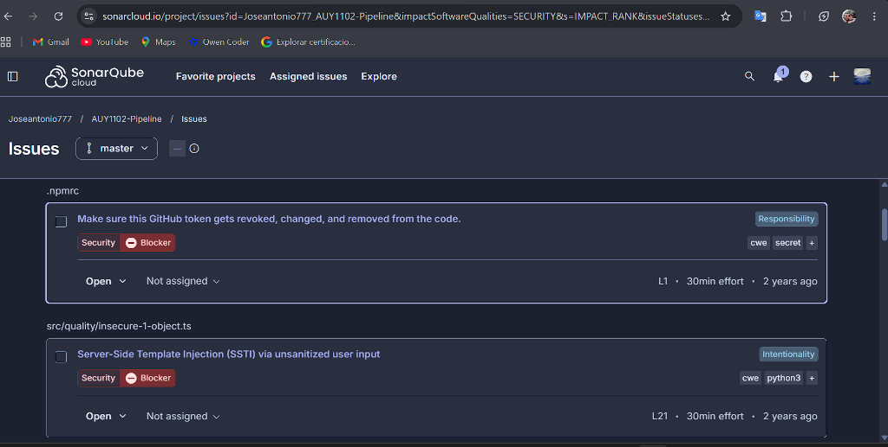
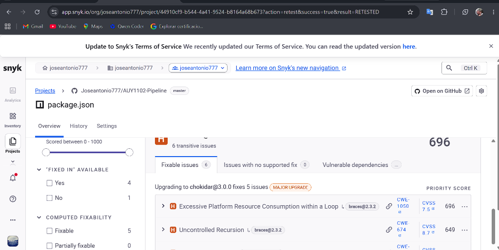

# AUY1102 - Pipeline: Seguridad y Vulnerabilidades del Código

Proyecto de la asignatura **AUY1102 - Ciclo de Vida del Software** (Evaluación EA2).
Repositorio basado en un fork de `Fundacion-Instituto-Profesional-Duoc-UC/AUY1102-Pipeline`, usado para practicar la detección y corrección de vulnerabilidades con herramientas de seguridad automatizadas.

> La documentación original del proyecto (inglés) está en [docs/README.en.md](docs/README.en.md).

## Objetivo

Activar y utilizar herramientas de seguridad de GitHub y de terceros para identificar, analizar y remediar vulnerabilidades, automatizando la detección en un entorno colaborativo.

## Herramientas de seguridad

| Herramienta | Función | Estado |
|---|---|---|
| Security Advisories | Publicación y consulta de avisos de seguridad | Habilitado |
| Dependabot alerts / security updates | Alertas y PR automáticos por dependencias vulnerables | Habilitado |
| Code scanning (CodeQL) | Análisis estático del código (`.github/workflows/codeql.yml`) | Habilitado |
| Secret scanning + push protection | Detección y bloqueo de secretos expuestos | Habilitado |
| Snyk | Análisis de paquetes, código y contenedores | Conectado |
| SonarCloud | Calidad y seguridad del código | Conectado |

## Evidencias


*Panel de seguridad de GitHub con las herramientas habilitadas.*


*SonarCloud: token expuesto en `.npmrc` e inyección de plantillas (SSTI) en `insecure-1-object.ts`.*


*Snyk: vulnerabilidades transitivas en `package.json`.*

## Vulnerabilidades encontradas y remediaciones

| Hallazgo | Origen | Remediación |
|---|---|---|
| Token de GitHub expuesto en `credentials.yml` | Secret scanning | Archivo eliminado y agregado a `.gitignore` (PR #4) |
| Token de GitHub expuesto en `.npmrc` | SonarCloud | Reemplazado por la variable `${NPM_TOKEN}` (PR #7) |
| Dependencias vulnerables (66 alertas iniciales) | Dependabot / Snyk | `npm audit fix` y PR de Dependabot (PR #5 y otros) |
| Inyección de código / SSTI en `src/quality/insecure-1-object.ts` | CodeQL / SonarCloud | La entrada del usuario se pasa como variable de `pug`, sin concatenarla (PR #7) |
| Registro de contraseña en texto claro en `src/quality/insecure-2-object.ts` | CodeQL | Se eliminó la contraseña del mensaje de log (PR #7) |
| Permisos faltantes en el workflow `pull_request.yml` | CodeQL | Se agregó `permissions: contents: read` (PR #9) |

> **Importante:** los tokens expuestos permanecen en el historial de git. Deben **revocarse** desde GitHub (*Settings → Developer settings → Personal access tokens*).

## Cómo ejecutar el proyecto

Requisitos: Node.js, npm y Visual Studio Code.

```bash
git clone https://github.com/Joseantonio777/AUY1102-Pipeline.git
cd AUY1102-Pipeline
npm install
npm run lint
npm run test:unit
```

Para autenticarse en el registro de GitHub Packages, defina la variable de entorno `NPM_TOKEN` con su token personal (nunca lo escriba directamente en el repositorio):

```powershell
$env:NPM_TOKEN = "<su-token>"
```

## Recursos

- [Seguridad en GitHub](https://docs.github.com/es/code-security)
- [Configurar Dependabot](https://docs.github.com/es/code-security/dependabot)
- [Configurar CodeQL](https://docs.github.com/es/code-security/code-scanning)
- [Snyk con GitHub](https://docs.snyk.io/integrate-with-snyk/git-repository-scm-integrations/github-integration)
- [SonarCloud con GitHub](https://docs.sonarsource.com/sonarqube-cloud/)
